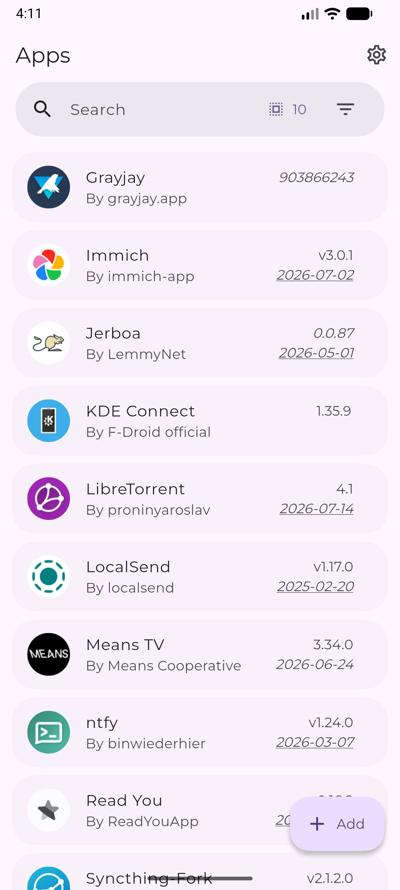
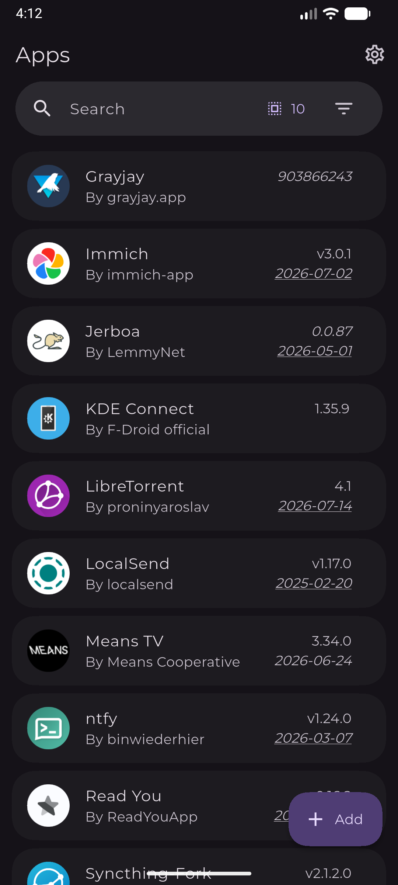
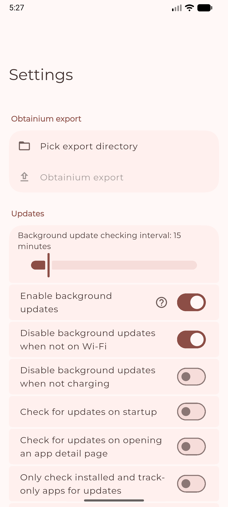
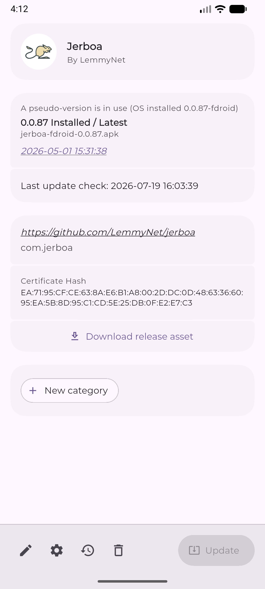
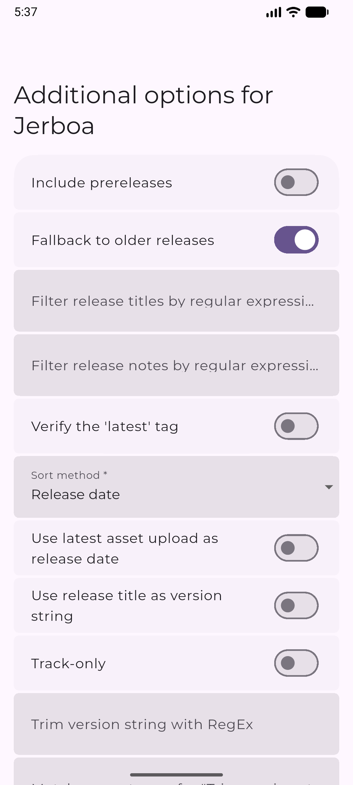
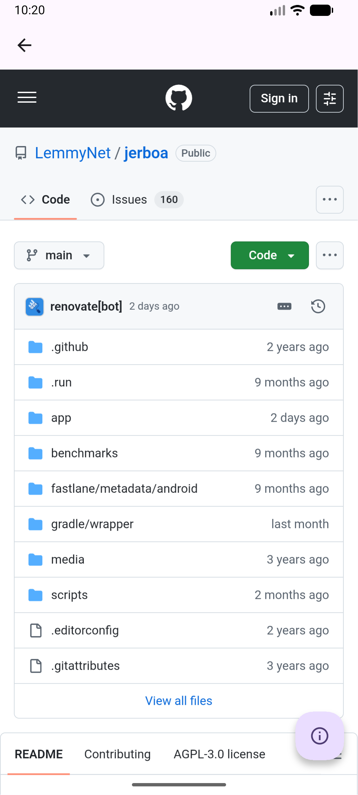

# Personal Obtainium

A fork of [Obtainium](https://github.com/ImranR98/Obtainium) (GPL-3.0) for a car head unit running Android 8.0 or newer. It keeps a fixed set of apps installed and up to date from a list on your own server.

## What it adds

- **Server sync.** When the app opens it sends `GET` to your app list URL. Every app on the list is added, installed if it is missing, and updated when its source has a newer release. Settings → Server sync has the URL, a "Sync now" button and the on-open switch.
- **Root is optional.** Without root, each install or update shows Android's install screen and needs one tap. If the unit is rooted and `su` grants access, the app switches itself to the root installer and installs silently, including background updates. Turn this off with "Use root for silent installs when available".
- **Own package id** (`dev.nikhil914.personalobtainium`), so it does not clash with upstream Obtainium, and it updates itself from this repository's releases.
- Apps from the server use "Filter APKs by device architecture" by default, so a release with per-ABI APKs picks the right one on its own.

## The app list

Serve any of these from your server (for example a static file behind nginx on EC2):

```json
["https://github.com/owner/app-one", "https://github.com/owner/app-two"]
```

```json
{"apps": ["https://github.com/owner/app-one", {"url": "https://github.com/owner/app-two", "settings": {"apkFilterRegEx": "arm64"}}]}
```

or plain text with one link per line (`#` starts a comment). `settings` takes any Obtainium per-app setting key. See [server/apps.example.json](server/apps.example.json). Plain `http://` works too. Any source Obtainium supports can be listed, not just GitHub.

Unauthenticated GitHub API calls are limited to 60 an hour. With many apps, add a GitHub token in Settings → Source-specific.

## Building

GitHub Actions builds APKs on every push and pull request (`.github/workflows/build.yml`). Download them from the run's artifacts.

- Set the repository variable `SERVER_SYNC_URL` (Settings → Secrets and variables → Actions → Variables) to bake your list URL into the build, so a fresh install syncs with no setup.
- For installable builds that can update each other, create a keystore once and add it as secrets:

  ```bash
  keytool -genkeypair -keystore release.jks -alias personal -keyalg RSA -keysize 2048 -validity 10000
  base64 -w0 release.jks   # paste into the KEYSTORE_BASE64 secret
  ```

  Then add `KEYSTORE_PASSWORD`, `KEY_ALIAS` (`personal`) and `KEY_PASSWORD`. Without them, CI signs with a throwaway key so you can still test, but the next build cannot update over it.
- Every push to `main` publishes a GitHub release tagged `v<version>` from `pubspec.yaml`, if that release doesn't exist yet. To ship a new release, bump `version:` (for example `1.7.4+2362`). You can also run the workflow by hand with "Publish a GitHub release" ticked. The app tracks these releases to update itself.

The rest of this README is upstream Obtainium's.

---

<!-- <div align="center"><a href="https://github.com/Safouene1/support-palestine-banner/blob/master/Markdown-pages/Support.md"></a></div> -->
<!-- Banner temporarily removed for reasons, will re-enable or replace shortly -->

##  Obtainium (upstream)

Get Android app updates straight from the source.

Obtainium allows you to install and update apps directly from their releases pages, and receive notifications when new releases are made available.

More info:
- [Obtainium Wiki](https://wiki.obtainium.imranr.dev/) ([repository](https://github.com/ImranR98/Obtainium-Wiki))
- [Deep Links](https://wiki.obtainium.imranr.dev/deep_links/) - link straight to an import, or add a badge to your own project
- [Obtainium 101](https://www.youtube.com/watch?v=0MF_v2OBncw) - Tutorial video
- ["Verified Apps"](https://github.com/privacyguides/verified-apps-android) - App verification tool (recommended, integrates with Obtainium)
- [apps.obtainium.imranr.dev](https://apps.obtainium.imranr.dev/) - Crowdsourced app configurations ([repository](https://github.com/ImranR98/apps.obtainium.imranr.dev))
- [Side Of Burritos - You should use this instead of F-Droid | How to use app RSS feed](https://youtu.be/FFz57zNR_M0) - Original motivation for this app
- [Website](https://obtainium.imranr.dev) ([repository](https://github.com/ImranR98/obtainium.imranr.dev))

Currently supported App sources:
- Open Source - General:
  - [GitHub](https://github.com/)
  - [GitLab](https://gitlab.com/)
  - [Forgejo](https://forgejo.org/) ([Codeberg](https://codeberg.org/))
  - [F-Droid](https://f-droid.org/)
  - Third Party F-Droid Repos
  - [IzzyOnDroid](https://android.izzysoft.de/)
  - [SourceHut](https://git.sr.ht/)
- Other - General:
  - [APKPure](https://apkpure.net/)
  - [Aptoide](https://aptoide.com/)
  - [Uptodown](https://uptodown.com/)
  - [itch.io](https://itch.io/)
  - [Huawei AppGallery](https://appgallery.huawei.com/)
  - [Tencent App Store](https://sj.qq.com/)
  - [vivo App Store (CN)](https://h5.appstore.vivo.com.cn/)
  - [RuStore](https://rustore.ru/)
  - [Farsroid](https://www.farsroid.com)
  - [Samsung Galaxy Store](https://galaxystore.samsung.com/)
  - [LiteAPKs](https://liteapks.com/)
  - [APK4Free](https://apk4free.net/)
  - [CoolApk](https://coolapk.com/)
  - [SourceForge](https://sourceforge.net/)
  - Jenkins Jobs
  - [APKMirror](https://apkmirror.com/) *(Track-Only)*
  - [APKCombo](https://apkcombo.com/)
  - [RockMods](https://rockmods.net/) *(Track-Only)*
- Other - App-Specific:
  - [Telegram App](https://telegram.org/)
  - [Neutron Code](https://neutroncode.com/)
- Direct APK Link
- "HTML" (Fallback): Any other URL that returns an HTML page with links to APK files

## Finding App Configurations

You can find crowdsourced app configurations at [apps.obtainium.imranr.dev](https://apps.obtainium.imranr.dev).

If you can't find the configuration for an app you want, feel free to leave a request on the [issues page](https://github.com/ImranR98/apps.obtainium.imranr.dev/issues).

Or, contribute some configurations to the website by creating a PR at [this repo](https://github.com/ImranR98/apps.obtainium.imranr.dev).

## Installation

[](https://github.com/ImranR98/Obtainium/releases)
[](https://apt.izzysoft.de/fdroid/index/apk/dev.imranr.obtainium)
[](https://f-droid.org/packages/dev.imranr.obtainium.fdroid/)
     
Verification info:

- Package name: `dev.imranr.obtainium`
- SHA-256 hash of signing certificate:
  ```text
  B3:53:60:1F:6A:1D:5F:D6:60:3A:E2:F5:0B:E8:0C:F3:01:36:7B:86:B6:AB:8B:1F:66:24:3D:A9:6C:D5:73:62
  ```
  - Note: The above signature is also valid for the F-Droid flavour of Obtainium, thanks to [reproducible builds](https://f-droid.org/docs/Reproducible_Builds/).
- [PGP Public Key](https://keyserver.ubuntu.com/pks/lookup?search=contact%40imranr.dev&fingerprint=on&op=index) (to verify APK hashes)

## Contributing / Developing

Please see the pertinent documentation, [on contributing](docs/CONTRIBUTING.md) and [the developer guide](docs/DEVELOPER_GUIDE.md) (architecture description).

## Limitations
- For some sources, data is gathered using Web scraping and can easily break due to changes in website design. In such cases, more reliable methods may be unavailable.

## Screenshots

|  |            |     |
| ------------------------------------------------------ | ----------------------------------------------------------------------- | -------------------------------------------------------------------- |
|    |  |  |
